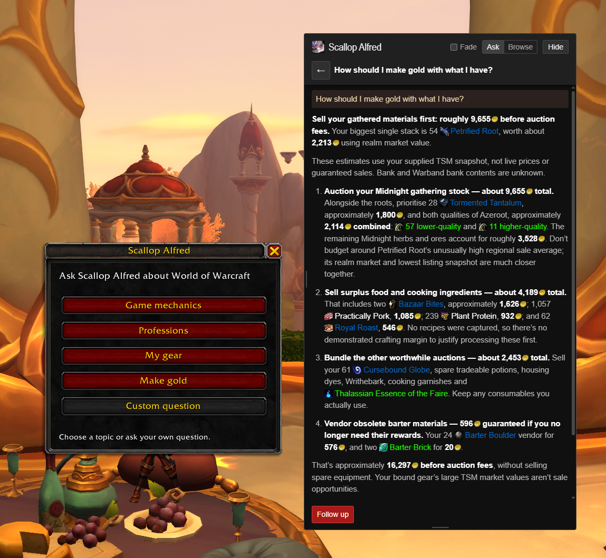
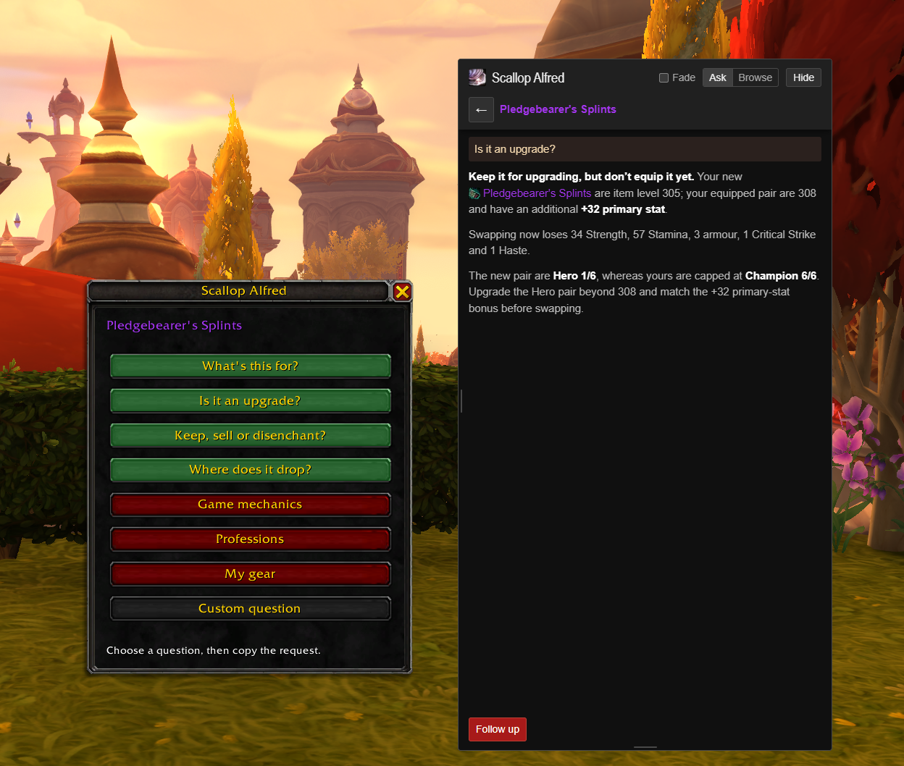
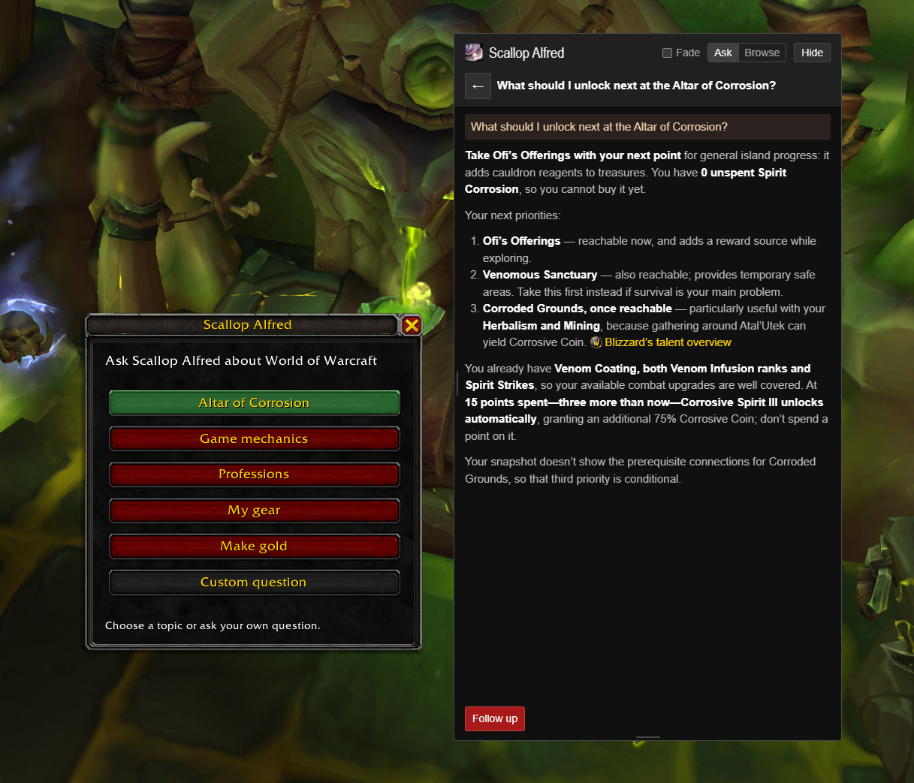

# Scallop Alfred

**Your AI sidekick for World of Warcraft.** Stop alt-tabbing to Wowhead. Hover anything, press Alt+Q, and Alfred answers in a window right on top of the game.



Alfred isn't a generic chatbot. He sees your character: class, spec, gear, bags, professions, and TradeSkillMaster prices if you have them. So you get answers about *your* stuff, not a guide written for someone else. He also checks the web for current patch notes and guides before answering.

## What you can ask

- **"Is it an upgrade?"** Hover a drop and Alfred compares it to what you're wearing, stat by stat.
- **"How should I make gold?"** He goes through your bags and recipes and ranks what's worth selling or crafting, in gold.
- **"Which Great Vault reward should I pick?"** Every option, weighed against your gear and talents.
- **"How do I earn this achievement?"** Step by step, with how far along you already are.
- **Delves:** what to buy at the Altar of Corrosion and which Corrosive Codex power to run.
- **Anything else.** Quests, spells, professions, mechanics, the NPC you're targeting. Shift-click up to eight links into one question.

## Install

It takes a few minutes. You need Windows, a ChatGPT account that includes Codex, and [Node.js](https://nodejs.org) 24 or later. Run WoW in windowed or windowed fullscreen mode.

1. On GitHub, click **Code** → **Download ZIP** and unzip it.
2. Rename the folder from `ScallopAlfred-main` to `ScallopAlfred` and move it to `World of Warcraft\_retail_\Interface\AddOns\`.
3. Open the folder in File Explorer, type `cmd` in the address bar and press Enter.
4. Run these, one at a time. `codex login` opens your browser to sign in to ChatGPT.
   ```
   npm install -g @openai/codex
   codex login
   npm install
   npm start
   ```
5. Restart WoW if it's open, then tick **Scallop Alfred** in the AddOns list.

Each time you play, repeat step 3 and run `npm start`. Keep it running while you play.

## Use it

Press **Alt+Q**, pick a question, then press **Ctrl+C**. Alfred starts answering straight away, and you can watch him search and think.

- **Hover something first** to ask about it: an item, spell, quest, currency or achievement. A targeted NPC works too.
- **Hover nothing** to get topics: **Game mechanics**, **Professions**, **My gear**, **Make gold** or **Custom question**.
- **Green buttons** appear when a window they need is open: **Great Vault**, **Selected achievement**, **Altar of Corrosion** and **Corrosive Codex**.
- **Follow up** by clicking the reply and pressing Enter, or type `/q` and your question in chat.





## Good to know

- **It doesn't touch the game.** The addon can't go online, so it hands you the question to copy. The app reads your clipboard and never presses keys or reads game memory.
- **Your question goes to OpenAI** under your ChatGPT account, with your character's name, level, gear and whatever the question needs. It counts against your ChatGPT plan's limits. Conversations are saved only on your PC.
- **For Make gold,** open your bank and the profession you craft with before asking. Alfred can only see what WoW shows.
- **The overlay** moves by dragging its top bar and resizes from its edges. **Hide** tucks it away, and the tray icon brings it back. **Browse** turns it into a small web browser.
- **No combat questions.** WoW locks addons during combat.

## Trouble?

- **Nothing happens after copying.** Make sure the app is running, with its scallop icon in your tray. Then copy the question again.
- **"Invalid Scallop Alfred request".** Type `/reload` in WoW and restart the app.
- **Alt+Q does something else.** Bind **Scallop Alfred: Ask about a tooltip or link** in WoW's keybindings.
- **The overlay hides behind WoW.** Switch WoW to windowed or windowed fullscreen.

<details>
<summary>Settings</summary>

Right-click the tray icon and choose **Open settings**. Save the file and restart the app.

| Setting | Default | What it does |
| --- | --- | --- |
| `model` | `gpt-6-astra` | The Codex model. Leave it empty for Codex's default |
| `codexPath` | empty | Where `codex.exe` is, if the app can't find it |
| `fontSize` | `14` | Text size, 12 to 28 |
| `theme` | `original` | `original` or `wowhead` |
| `fade` | `false` | Makes the overlay see-through until you point at it |
| `timeoutSeconds` | `180` | How long to wait for an answer, 10 to 600 |
| `width`, `height` | `380`, `640` | Overlay size in pixels |
| `x`, `y` | `null` | Overlay position. `null` puts it near the top right |
| `browseUrl` | `https://x.com` | Where Browse opens. It updates to the last page you visited |

Codex runs read-only with web search on, and can't run commands or use plugins and MCP servers. Your other Codex settings still apply.

</details>

<details>
<summary>For developers</summary>

`npm run check` type-checks the app and tests. `npm test` runs the addon's Lua against a mocked WoW API and drives the real Electron app with a fake clipboard and Codex. The mocks can't prove everything works in game, so check changes in WoW too.

</details>

## Licence

The code is [MIT licensed](LICENSE). The shell and coin icons in `assets` belong to Blizzard Entertainment and aren't covered by it. This project isn't affiliated with Blizzard, OpenAI, Wowhead or TradeSkillMaster.
